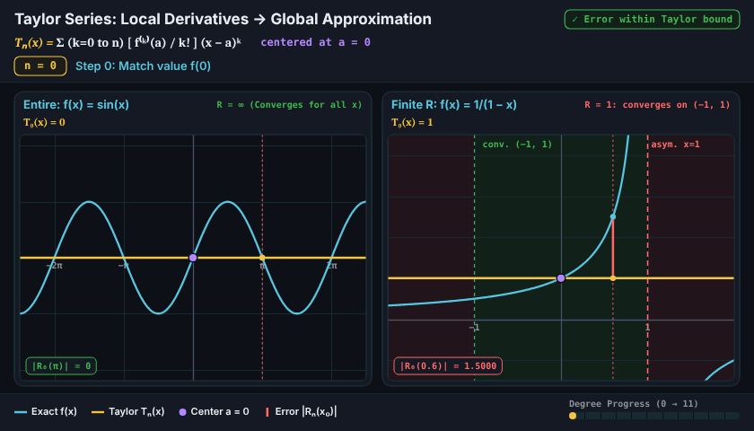

# Taylor Series Explorer — Calculus II

Interactive Taylor series animations for Calc 2, with the math checked live.

**Live site:** https://codeted323.github.io/taylor-series-explorer/

## Pages

- **[Interactive explorer](https://codeted323.github.io/taylor-series-explorer/)**: sin x, cos x, eˣ, ln(1+x) and 1/(1−x). Animate the degree n, move the center a, and drag a probe point to compare the actual error with the Lagrange error bound.
- **[GIF maker](https://codeted323.github.io/taylor-series-explorer/gif.html)**: build your own looping GIF (choice of functions, max degree, size and speed) and download it.

## What the checks do

Before anything is shown, each page checks that:

1. the starting values are right (c₀ = f(a), and c₁ matches a slope measured from f itself);
2. every coefficient obeys the differential equation the function satisfies (for example f″ = −f for sin), which pins down every coefficient uniquely; and
3. the actual error |f(x) − Tₙ(x)| never exceeds the Lagrange remainder bound.

These are computer checks at sample points. They catch formula and code mistakes; the underlying guarantee is Taylor's theorem itself. For ln(1+x) and 1/(1−x), the explorer shades in amber the part of the convergence interval where the Lagrange bound is too loose to prove convergence (the series still converges there).

Each page is a single HTML file and needs no build step.
